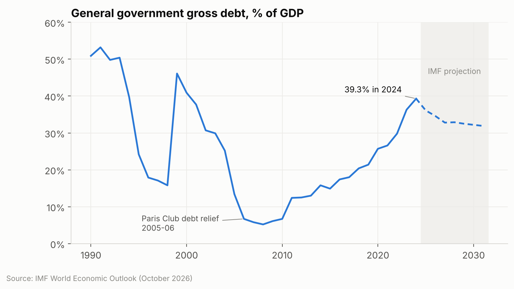
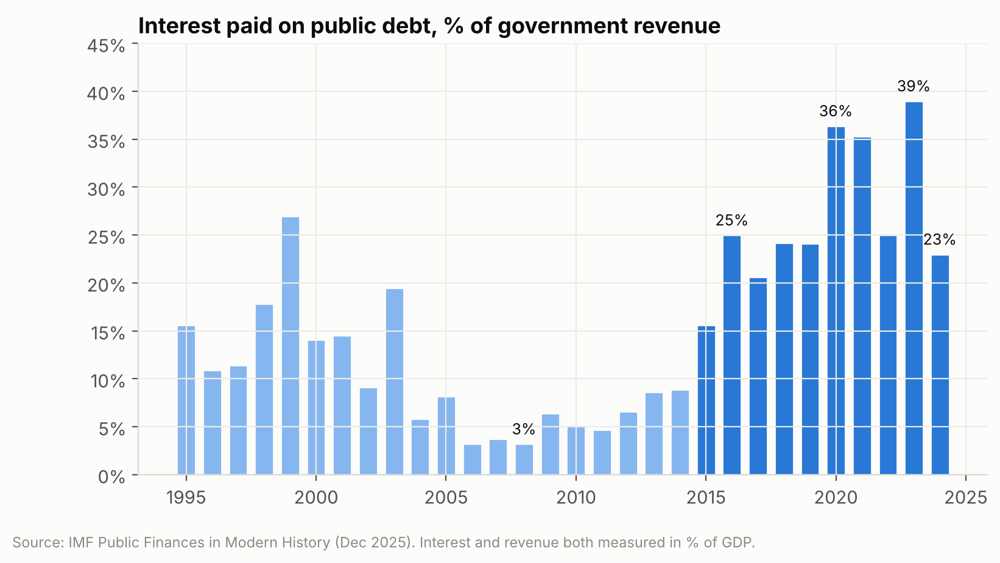
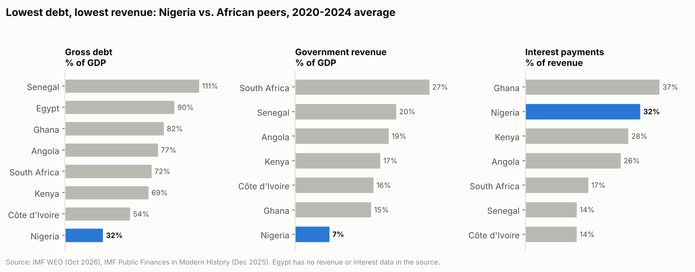
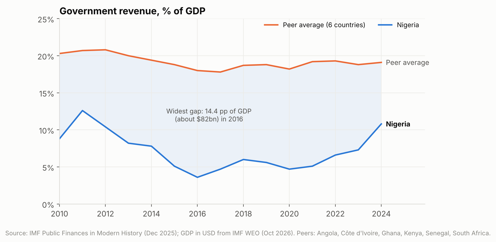

# Nigeria's public finances: a debt problem or a revenue problem?

Nigeria's government debt rose from about 5% of GDP in 2008 to 39% in 2024, and debt service dominates the country's economic debate. This project uses IMF data, SQL and Python to test a simple question: **is the problem how much Nigeria borrows, or how little it collects?**

## Key findings

1. **Nigeria has the lowest debt ratio of eight large African economies** (32% of GDP on average in 2020-2024, against 54-111% for the peers).
2. **Yet it spent the second-largest share of revenue on interest** (about 32% in 2020-2024), behind only Ghana, which defaulted in 2022.
3. **The cause is revenue, not debt.** Government revenue collapsed after the 2014-15 oil-price crash and averaged only about 5% of GDP in 2015-2022, half its 2006-2014 level. Peers collect 15-27%.
4. **The revenue gap is huge.** Between 2010 and 2023 Nigeria collected 8-14 percentage points of GDP less than the peer average, roughly $48-95bn a year.
5. **Revenue is the lever that works.** When revenue rose to 10.8% of GDP in 2024, interest fell from 39% to 23% of revenue in a single year, even though debt kept rising.









## Data

| Source | Indicators | Coverage |
|---|---|---|
| IMF World Economic Outlook (October 2026) | General government gross debt, overall balance, real GDP growth, inflation, GDP in USD, population | Nigeria 1990-2031 (2025+ are projections); debt for 7 peers 2010-2024 |
| IMF Public Finances in Modern History (December 2025) | Government revenue, expenditure, interest paid, primary balance | Nigeria 1990-2024; revenue and interest for 6 peers 2010-2024 |

Peers: Angola, Côte d'Ivoire, Egypt, Ghana, Kenya, Senegal, South Africa. Egypt has no revenue or interest data in the source, so it appears only in the debt comparison.

All data comes from the free [IMF DataMapper API](https://www.imf.org/external/datamapper/api/help) and was retrieved on 2 November 2026.

## Method

1. **Extract**: `src/fetch_data.py` downloads the indicators from the IMF API into `data/raw/` as JSON.
2. **Transform and load**: `src/build_db.py` reshapes the data into one tidy table (country, indicator, year, value), flags IMF projections, runs validation checks (no duplicates, no missing values, no negative ratios) and loads it into a SQLite database with `countries`, `indicators` and `observations` tables.
3. **Analyse with SQL**: `sql/analysis.sql` holds five named queries using CTEs, conditional aggregation (pivoting), and window functions (`LAG`, `RANK`).
4. **Visualise and explain**: `notebooks/analysis.ipynb` runs those queries, builds the charts and writes up the findings.

The key derived metric is **interest paid as a share of revenue** (interest ÷ revenue, both in % of GDP), which shows how much of what the government collects is already committed to creditors.

## Limitations

- Revenue, expenditure and interest come from a different IMF dataset than debt. Their coverage of government levels may differ, so cross-dataset ratios are indicative rather than exact.
- Official Nigerian figures for *federal* debt service as a share of *federal* retained revenue are much higher than the ratio used here, because the federal government keeps only part of total revenue. This project uses consolidated IMF figures so countries can be compared on the same basis.
- 2024 is the latest year of actual data. Debt figures from 2025 onward are IMF projections and are shown dashed.
- Peer averages are simple, unweighted means.

## Run it yourself

```bash
git clone https://github.com/laposk91/nigeria-fiscal-analysis.git
cd nigeria-fiscal-analysis
pip install -r requirements.txt

python src/fetch_data.py    # optional: refresh the raw data from the IMF API
python src/build_db.py      # build data/processed/fiscal.db
jupyter notebook notebooks/analysis.ipynb
```

You can also query the database directly:

```bash
sqlite3 data/processed/fiscal.db < sql/analysis.sql
```

## Project structure

```
├── data/
│   ├── raw/              IMF API extracts (JSON)
│   └── processed/        SQLite database and tidy CSV
├── sql/analysis.sql      analysis queries
├── src/
│   ├── fetch_data.py     download raw data
│   ├── build_db.py       clean, validate and load
│   └── make_notebook.py  generates the notebook from code
├── notebooks/analysis.ipynb
└── charts/               exported figures
```

## Skills demonstrated

SQL (CTEs, window functions, pivoting with conditional aggregation, joins) · Python (pandas, matplotlib) · API data extraction · data cleaning and validation · relational schema design · data visualisation · writing findings for a non-technical audience
